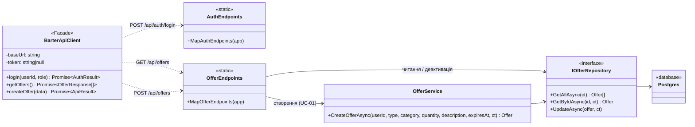
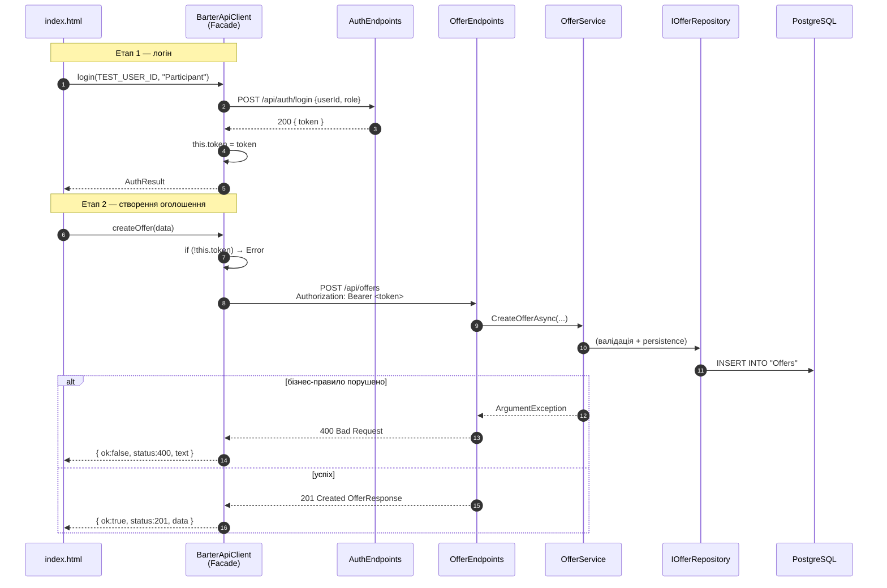

# Модель реалізації — клієнтський Фасад `BarterApiClient`

> Документ описує **новий клієнтський клас** `BarterApiClient`
> (`wwwroot/js/api-client.js`), який реалізує патерн **Facade** на фронтенді
> та інкапсулює всю взаємодію з REST-API CyberpunkNeonBarter.

---

## 1. Призначення Фасаду

До появи `BarterApiClient` кожен екран `index.html` звертався б до сервера
напряму через `fetch`, дублюючи:

- формування URL та заголовків `Content-Type: application/json`;
- додавання `Authorization: Bearer <token>`;
- перевірку `response.ok` та парсинг `json()` / `text()`;
- обробку помилок мережі та бізнес-правил (400).

`BarterApiClient` **приховує цю складність** за трьома методами
(`login`, `getOffers`, `createOffer`) і виступає єдиною точкою входу
для UI-шару. UI тепер не знає ні про HTTP, ні про JWT, ні про формат
помилок сервера.

---

## 2. Діаграма класів (Facade ↔ Server)



> 🔹 Пунктирні стрілки — це **HTTP-виклики** (мережева межа).
> 🔹 Суцільні — внутрішньосерверні залежності через DI.

---

## 3. Послідовність: `login()` → `createOffer()`



---

## 4. Відображення «метод Фасаду ↔ серверний обробник»

| Метод `BarterApiClient` | HTTP | Endpoint | Обробник на сервері | Авторизація |
|---|---|---|---|---|
| `login(userId, role)` | `POST` | `/api/auth/login` | `AuthEndpoints.MapAuthEndpoints` (Minimal API) | ❌ анонімно |
| `getOffers()` | `GET` | `/api/offers` | `OfferEndpoints` → `IOfferRepository.GetAllAsync` | ✅ `Bearer` |
| `createOffer(data)` | `POST` | `/api/offers` | `OfferEndpoints` → `OfferService.CreateOfferAsync` | ✅ `Bearer` |
| *(майбутнє)* `deleteOffer(id)` | `DELETE` | `/api/offers/{id}` | `OfferEndpoints` (DeleteOffer) | ✅ `Bearer` |
| *(майбутнє)* `findCycle()` | `POST` | `/api/cycles/find` | `CycleEndpoints` + `CycleFinderService` | ✅ `Bearer` |
| *(майбутнє)* `confirmDeal(id, uid)` | `POST` | `/api/deals/{id}/confirm` | `DealEndpoints` (UC-03) | ✅ `Bearer` |

> Фасад — **відкритий для розширення** (можна додати методи без змін
> у UI), але **закритий для змін** існуючого контракту трьох методів.

---

## 5. Контракт методів Фасаду

### 5.1 `login(userId: string, role: "Participant"|"Admin") → Promise<AuthResult>`

- Бічна дія: **зберігає** `this.token` для наступних викликів.
- При помилці (HTTP ≠ 2xx) **кидає** `Error('Помилка сервера при вході')` —
  UI ловить у `try/catch` навколо `login()`.

### 5.2 `getOffers() → Promise<OfferResponse[]>`

- Прокидає `Authorization: Bearer <token>`.
- При помилці **кидає** `Error('Помилка завантаження оголошень')`.
- Повертає масив; **фільтрація за категорією** зараз виконується на
  клієнті в `index.html` (`loadOffers` + `getCategoryName`).

### 5.3 `createOffer(data) → Promise<{ ok, status, data?, text? }>`

- **Не кидає** виняток на 4xx — повертає структурований результат,
  щоб UI міг показати бізнес-помилку 400 (`ArgumentException` з
  `OfferService`) окремим повідомленням.
- Успіх: `{ ok: true, status: 201|200, data: OfferResponse }`.
- Помилка: `{ ok: false, status: 400|401|500, text: <сирий body> }`.

---

## 6. Розміщення у структурі проєкту

```text
wwwroot/
├── index.html                # View — використовує глобальний `apiClient`
└── js/
    └── api-client.js         # ← Facade (цей документ)
```

Екземпляр створюється **один раз** у глобальній області:

```js
const apiClient = new BarterApiClient('');   // baseUrl = '' → same-origin
```

Усі сторінки (`index.html`) працюють із цим самим singleton-екземпляром —
тобто `token` переживає перемикання панелей `showPanel(...)`.

---

## 7. Переваги та обмеження

| ✅ Переваги | ⚠️ Обмеження (борг) |
|---|---|
| Єдина точка входу для HTTP-викликів | Токен зберігається лише в пам'яті — при `F5` сесія губиться |
| UI не знає про JWT/заголовки | `userId` для `createOffer` береться з `TEST_USER_ID`, а не з JWT-claims |
| Обробка 400 окремо від 401/500 | Немає `refresh`-логіки для протермінованого токена (2 год) |
| Легко мокати у тестах | Фільтрація оголошень — на клієнті (дублює `OfferFilterDto`) |
| Легко розширюється новими методами | Немає методу `deleteOffer` — UC-деактивація не покрита фасадом |